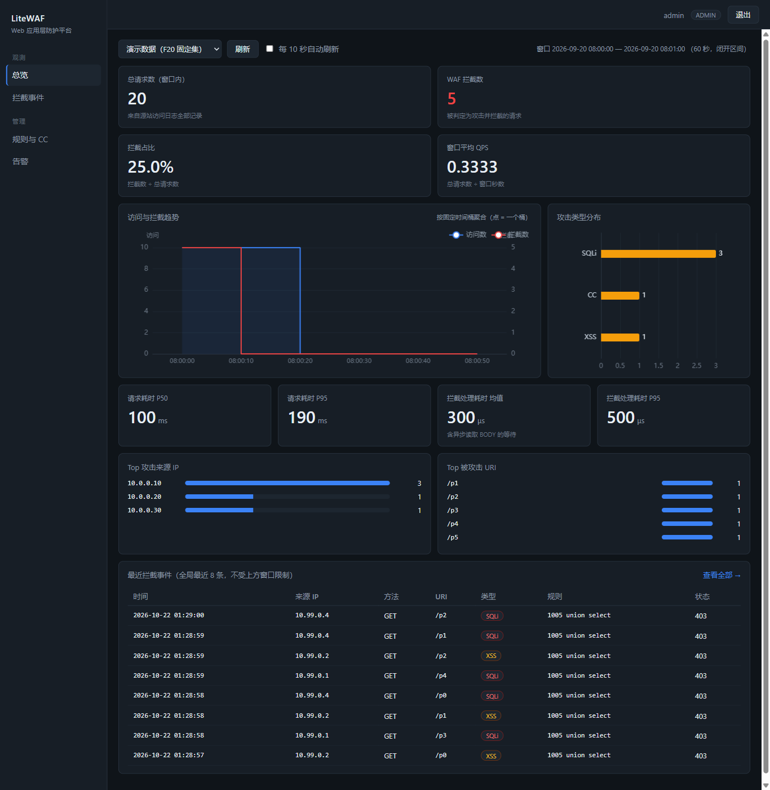

# LiteWAF · Web 应用层攻防实战系统

基于 Nginx 的应用层防火墙（WAF）：**C 语言检测引擎跑在 Nginx 进程内**（不加一跳反代），日志经采集器入 MariaDB，Spring Boot 平台提供规则发布/告警/评估/审计，Vue 控制台做可视化，附一套可一键复跑的验收脚本。

课程项目：电子科技大学信软学院《进阶式挑战性综合项目 III》。引擎部分基于 `Llogib/WAF-lite`（`dev_2` 分支）继续开发。



## 能做什么

| 层 | 能力 |
|---|---|
| **检测** | SQLi / XSS / 路径穿越 / RFI / 编码绕过 / 恶意上传 / 扫描器 UA 七类规则（38 条，PCRE2）；CC 漏桶限速封禁；请求体硬上限（超 8KB 直接 413）；黑/白名单 CIDR；XFF 可信代理 |
| **观测** | 实时总览（KPI/趋势/分类/Top IP/最近事件，SSE 推送 3 秒内滚入）、拦截事件检索与详情、按 IP 24 小时关联、CSV/JSONL 脱敏导出 |
| **管理** | 规则在线编辑 → 语法检查 → 发布（原子替换 + reload + 三次探测，失败自动回滚）→ 版本审计与一键回退；规则试打（dry-run，不发到线上）；CC 参数随规则一起发布 |
| **告警** | 阈值 + 固定窗口 + 抑制合并 + Webhook 投递（失败重试、重试记录），消费者游标可观测 |
| **评估** | 201 条带标签样本离线跑分（TP/FN/FP/TN、FNR/FPR、分类检出、漏报误报明细、历史跑次对比）、误报标记闭环（人工复核 + 三指标分名） |
| **运维** | 15 项一键验收、一键启停、systemd 崩溃自愈、采集器心跳与接口耗时、数据库备份/恢复、日志轮转与数据保留 |

## 架构

```
客户端
  │
  ▼
Nginx (18010) ── LiteWAF 模块（C，ACCESS_PHASE，进程内判定）
  │                 ├─ 规则引擎 src/lwaf_rule_engine.c（可独立单测）
  │                 ├─ CC 漏桶（共享内存 + 毫秒级漏水）
  │                 └─ 审计日志 JSONL（UTC 毫秒）
  ├─► access.log + waf_audit.log
  │            │
  │            ▼
  │      采集器（Python，游标 + 幂等 + 轮转重读，批 ≤500 行）────────────┐
  │                                                                      ▼
  │                                                            MariaDB 11.8（11 张表）
  │                                                                      │
  └─► 静态资源                                          Spring Boot 3.5.6 API (18080)
                                                                         │
                                            ┌───────────────┬────────────┴──────────┐
                                            ▼               ▼                       ▼
                                     Vue 3 控制台 (18082)  告警 Worker            引擎执行器 (18081)
                                     ECharts + SSE        2 秒消费/10 秒重试      check / publish / rollback / status
```

关键取舍：

- **检测在 Nginx 进程内**，不是反向代理再转发一层，延迟和单点都省了
- **控制台只读不重算**：统计 SQL 都在后端，前端不做二次聚合
- **改规则走五步**（编辑 → check → publish → 探测 → 回滚），不直接改线上文件
- **采集器幂等**：唯一键 `source + file_identity + generation + offset`，重跑不重复入库，文件轮转/截断自动开新代次

## 目录

| 路径 | 内容 |
|---|---|
| `WAF-lite/` | C 引擎：Nginx 模块、规则引擎、规则文件、单测、14 步验收脚本 |
| `platform/backend/` | Spring Boot 平台后端（统计/事件/鉴权/规则/告警/评估/导出/性能） |
| `platform/frontend/` | Vue 3 控制台（总览/事件/规则/告警/误报/评估/性能七个页面） |
| `platform/collector/` | 日志采集器 |
| `platform/engine/` | 引擎执行器（唯一改动线上实例的进程） |
| `scripts/` | 部署与验收脚本（初始化、启停、重建、一键验收、演练） |
| `docs/` | 使用说明、工作报告 |
| `artifacts/` | 验收截图 |

## 快速开始

需要一台 Linux（开发和验收都在 Kali 2026.3 虚拟机上做），依赖 nginx 1.24.0、PCRE2、gcc、JDK 25、Maven 3.9、Node 20+、MariaDB 11.8、Python 3.13。

```bash
# 1. 初始化运行时目录与配置（首次）
sudo bash scripts/s5_init_runtime.sh

# 2. 一键启动全部服务（幂等，约 25 秒）
sudo bash scripts/s10_start_all.sh

# 3. 一键验收（15 项必选）
bash scripts/s7_accept.sh --skip-engine

# 4. 引擎 14 步全量验收（会短暂停掉线上实例）
sudo bash scripts/s11_engine_check.sh

# 5. 201 条样本评估
python3 scripts/s8_eval.py --gap 0.7
```

启动后浏览器打开 `http://<linux-ip>:18082`，账号见 `docs/使用说明.md`。停止用 `scripts/s10_stop_all.sh`。

## 实测数据

| 项目 | 结果 |
|---|---|
| 201 条带标签样本 | **TP=98 / FN=2 / FP=0 / TN=101**，准确率 99.00%，检出率 98.00%，误报率 0% |
| 分类检出 | SQLi 48/50、XSS 50/50、正常误拦 0/101 |
| 引擎 14 步全量验收 | `FINAL ACCEPTANCE PASSED` |
| 平台 15 项一键验收 | 全 PASS、0 失败 |
| ab 正常请求 | 5000 请求 / 0 失败 / 22786 RPS |
| ab 攻击请求 | 1000 请求 / 全部 403 / 18947 RPS |
| soak 30 秒混合流量 | 2400 请求 / 0 失败 / 79.98 RPS / **P95 1395 µs、P99 2219 µs** |
| 崩溃恢复 | `kill -9` 后 systemd 4.1 秒拉起 |
| 采集吞吐 | 12 万行日志 5 秒入库 |

剩余 2 条漏报是函数型盲注（`OR CHAR(65)=CHAR(65)`、`AND SUBSTRING((SELECT database()),1,1)>0`）：关键字表里没有这些函数名，补规则能拦但会带误报风险，作为已知限制保留。

## 技术栈

C · Nginx 1.24.0 · PCRE2 10.48 · Python 3.13 · Spring Boot 3.5.6 · Spring Security + JWT · JDK 25 · MariaDB 11.8 · Vue 3.5 · Vite 7 · Pinia 3 · ECharts 6.1 · Kali 2026.3 · systemd

## 文档

- [`docs/使用说明.md`](docs/使用说明.md) — 部署、启停、验收、常见问题
- [`docs/工作报告.md`](docs/工作报告.md) — 完成度、实测数字、架构取舍、踩过的坑、已知限制
- [`WAF-lite/docs/基线说明.md`](WAF-lite/docs/基线说明.md) — 引擎侧规则集/打分机制/性能基线与复现坑

## 已知限制

- 单机单实例单站点部署，不做多租户和集群
- 只对 SQLi / XSS / CC 做承诺级覆盖，其余类别规则较薄
- CC 是漏桶近似（`max_requests` 次 / `window` 秒，超过即封 `block_duration` 秒），不是精确令牌桶
- 登录态 30 分钟，刷新页面靠 localStorage 续期
